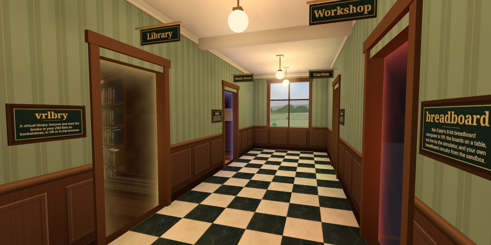

# Hallway

**https://ariamokr.github.io/hallway/**

A WebXR corridor whose doors lead to other environments:
[vrlbry](https://ariamokr.github.io/vrlbry/), a candle-lit virtual library;
[Breadboard 8-bit](https://ariamokr.github.io/breadboard/vr.html), Ben Eater's 8-bit breadboard
computer in 3D, run live by its simulator; [music](https://ariamokr.github.io/music/), a music
room where Project Gutenberg's books on music play their scores;
[Outside](https://ariamokr.github.io/outside/), a small garden with a stream, a pond and a bench to
read on; and two rooms still empty, [art](https://ariamokr.github.io/art/), soon a gallery of art,
and [video](https://ariamokr.github.io/video/), soon a room to watch videos in. Walk the hallway in
VR on a Meta Quest, on a desktop or on a phone, with nothing to install, or on an Android TV with
its remote, in [the TV app](#the-tv-app).



Each open doorway shows the room behind it: the environment's picture, seen with parallax (and
depth, in a headset), behind a glowing veil. A door without a picture shows its name instead.
Walk through it, click or tap it, or point at it in VR and pull the trigger, and the page goes
there. When you come back, by the environment's own link or with Back, you start in front of the
door you left by. Doors with no environment yet are drawn closed.

## Moving about

| | Look | Walk | Go through a door |
|---|---|---|---|
| Desktop | drag | WASD or arrows (Shift runs), Q/E or ←/→ turn, click the floor | click it, or walk into it |
| Phone | drag | tap the floor | tap it |
| Headset | your head | left stick walks (or aims a teleport), right stick turns, trigger at the floor teleports | trigger (or pinch) at it, or step through it |
| Gamepad | right stick | left stick (click it in to hurry) | aim the dot at it and press A, or walk into it |
| TV remote | ← and → turn | ↑ and ↓ | aim the dot at it and press OK, or walk into it |

A gamepad (Xbox, PlayStation or another Bluetooth pad) works on a desktop or a phone, as it does
in vrlbry: it takes over as soon as you use it, and moving the mouse hands control back. While it
is in use, a dot in the middle of the view shows what A uses (a door, a button on the control
panel, or a spot on the floor to walk to), and grows when it is on something. Browsers show a
page a gamepad only once one of its buttons has been pressed.

**Fullscreen**, at the bottom right beside Enter VR, fills the screen with the hallway. To leave
it, press **✕ Exit fullscreen** in the same place, Esc, or B or Back on a gamepad (Back is also
called View, Select, Share or −). A browser that cannot go fullscreen, such as an iPhone's, shows
no button.

A control panel hangs on the right-hand wall, between the entrance and the first door. Point at
it (or click it) to enter or exit VR, and to choose how to move in VR:

- **Move: Smooth** (the default): the left stick walks the way you face.
- **Move: Teleport**: push the left stick forward, aim that controller's ray at the floor, and let
  go to be there.
- **Turn: Snap** (the default): the right stick turns you 30° at a time.
- **Turn: Smooth**: the right stick turns you while held.

The trigger (or a pinch) at the floor teleports in either mode, and every teleport blinks the
view black for a moment. The choices are kept in this browser, for the hallway and the places
behind its doors.

Under them, three settings every site behind the doors shares (kept under `hallway.access`):

- **Motion: System** (the default) follows the device's own reduce-motion setting; **Less** and
  **Full** override it. With less motion, clicking the floor or a door puts you there at once
  instead of walking, the fades are blinks, the doorways' veils hold still, and someone waving
  doesn't bob (the message still says they waved).
- **Vignette: On** (the default): in VR, while the sticks walk or turn you smoothly, the edge of
  the view darkens and closes in, and opens again when you stop. It eases the motion sickness
  smooth movement gives some people.
- **Seated: On** raises the view 0.45 m in VR, so you see from about standing height sitting down.

The same choices, and Start / Leave shared session, are under **Settings** in the card with the
doors list, as ordinary controls a keyboard or a screen reader can reach. The doors list is the
hallway as text: each door is a link, its name in a tint of its glow that reads at 4.5:1. On a
short screen, such as a phone's or one turned on its side, the card scrolls.

## The TV app

On an Android TV the hallway runs in [AriaMoKr/HallwayApp](https://github.com/AriaMoKr/HallwayApp),
an app that is this site in a full-screen WebView; its README says how to install it. The app ends
its user agent with ` HallwayTV/<version>`, and the page then shows the 10-foot view: larger text in
the card and on the control panel, and a thick focus ring on a dark halo, to be seen across the
room. There is no Enter VR or Fullscreen. The hint at the foot of the screen says what the keys do.

- **Walking**, ↑ and ↓ walk and ← and → turn. A dot in the middle of the view shows what **OK**
  uses, as a gamepad's A does: a door, a button on the control panel, or a spot on the floor.
- **Menu**, or holding **Back**, moves the focus into the card: the doors list, Together and
  Settings. There ↑ and ↓ go from control to control (a choice, such as Motion, is one stop), ← and
  → change a choice, and OK presses or ticks. **Back** or Menu walks again, and Menu comes back to
  the control left until the page changes.
- **Back**, walking, goes back a page: from a room behind a door, to that door in the hallway; from
  the hallway, out of the app.
- **Together.** A TV can't copy a link, so the Together section shows the invite link to open on a
  phone or a computer. To join a session started elsewhere, type its room (`k3vd-q8hn`, the end of
  its invite link) or the link under Settings, **Or join one by its room**: OK on the box opens the
  TV's keyboard.

A gamepad paired with the TV works as it does anywhere: the app's WebView passes it to the page.
With TalkBack on, the remote's arrows can't walk: on a TV, TalkBack takes them for its own focus
before any app gets them, whatever the page says it is (`role="application"` changes nothing). They
move that focus through the view and the card's controls instead, reading each one, and OK presses
the control it is on, so the settings can be changed that way. OK on the view still reaches the
page and uses what the dot is on. And **channel up and down** still walk, and **rewind and
fast-forward** turn, as the hint says: TalkBack leaves the remote's channel and media keys to the
page, which reads those four as the arrows. A gamepad still walks and turns too: TalkBack leaves its
sticks alone.

The app asks the page what Back and Menu do: it calls `window.hallwayTV.back()` or `.menu()`, and
the page returns true when it used the key. Without that (the other sites behind the doors don't
define it yet), Back goes back a page, or out of the app, and Menu does nothing. The other sites run as
they are, with their own keys: the arrows walk in most of them, and HallwayApp's README notes what
the remote can't reach in each.

The TV mode is [AriaMoKr/common](https://github.com/AriaMoKr/common)'s `tv.js`: knowing it is the
app, the remote and its card, the spare keys for TalkBack, and the answer to Back and Menu. Its
README's "The TV app" has the checklist the sites behind the doors follow to work with the remote.
The hallway's own part is joining a session by its room.

`?tv=emulate` shows the TV's page in any browser, with the arrows, Enter for OK and Escape for
Back in the card. Menu is the app's, so there `__hallway.remote.menu()` stands in for it.

## Together

The panel's **Start shared session** (or the one under Settings) makes a room and puts it in the address
(`?room=k3vd-q8hn`). That address is the invitation: anyone who opens it joins the room and sees
the others in the hallway, each as a head with a visor on its front, their hands in VR, a ring on
the floor and their name. Arrivals stand on different spots, at the entrance or in front of the
door they came back through, so two who arrive together don't stand inside each other. On a
screen, **Copy invite link** at the bottom right copies the link. **Leave shared session** leaves
the room and takes it out of the address.

While in a session:

- **Your name.** The Together section under the doors list has your colour and your name, "Guest"
  and four letters until you change it. Type a new one and press Enter. Set it before entering VR:
  there is no typing in a headset. The name is kept for the tab and as this browser's name for new
  tabs, on every site of `ariamokr.github.io` (the layer's test page and the environments that
  take part too).
- **Who's here.** The same section lists the others: their colour, name, where they are ("here" in
  the hallway, an environment's title, or "elsewhere") and the round trip to them in ms. The panel
  shows up to four of them and where they are, then "+N more", for VR.
- **How it's going.** The status, in the section and on the panel: "Connecting…" while the session
  starts, "Can't reach the relays" if none answers within 10 s, "Offline" when the browser is,
  "Waiting for others" with nobody else in the room yet, else how many others are here and
  elsewhere. "Couldn't connect to N visitors" means handshakes failed, usually a network that needs
  a TURN relay (the layer's README, Limits).
- **Wave.** The **Wave** button at the bottom right, or a controller's grip in VR (it pulses, so
  you feel it go out), waves to everyone: your head bobs and your name lifts for a moment in their
  hallway, and they get a toast saying you waved. Someone on another page gets the toast only.

The doors keep the session going. A door's link carries the room (`room`, see common's
[Going in](https://github.com/AriaMoKr/common#going-in)), and so does its way back. Going through
a door, the visitor leaves the room at once, so the others see them go. They rejoin when they
come back, and on the other side too once an environment takes part (none does yet). A visitor in
the session but on another page counts as elsewhere.

It runs peer to peer over WebRTC, with no server of its own:
[Trystero](https://github.com/dmotz/trystero) finds the other visitors through public Nostr
relays. The layer on top, [AriaMoKr/layersharedsession](https://github.com/AriaMoKr/layersharedsession),
loads only when a session starts. Its [test page](https://ariamokr.github.io/layersharedsession/),
opened with the same `?room=`, lists everyone in the session with their round-trip times and
logs who came, went, renamed and waved. Its Wave and the hallway's reach each other.

## Running it

```bash
npm install     # three.js, common, the shared-session layer and Trystero (and IWER, for emulating a headset), copied into public/vendor/
npm start       # http://localhost:8088/
npm test
```

It needs Node 22 or later: the tools that drive a Quest use its built-in WebSocket.

`public/` is the whole site: any static server can serve it once `npm install` has filled
`public/vendor/` with what [`vendor.json`](vendor.json) lists (common's vendor copy, run as the
postinstall). WebXR needs a secure context. `http://localhost` counts as one. `npm start` is
common's dev server on the hallway's port, 8088 (`tools/serve.mjs`).

A Quest connected over adb can open the dev server as `http://localhost:8088/` after
`adb reverse tcp:8088 tcp:8088`, as long as the server listens on IPv4. `npm start` listens on
`localhost`, which can mean IPv6 only (`::1`, as on Windows), and the headset's connections then
never arrive. For a headset, start it as:

```bash
npm start -- --host 127.0.0.1
```

`?xr=emulate` installs Meta's IWER emulator (a virtual Quest 3), so the VR mode can be tried
without a headset.

`node tools/quest-check.mjs` checks the hallway on a Quest connected over adb, which nobody needs
to wear. It opens the published site, or the dev server with `--local` (started as above), enters
VR, times the frames while walking the hall, presses the panel's settings and Exit VR, and writes
a report to `perf/` (`--help` lists the options).

## Adding a door

Add an entry to [`public/js/environments.js`](public/js/environments.js), and a link to the
`<noscript>` list in [`public/index.html`](public/index.html) (a test checks that one is there):

```js
{
  id: 'garden',                         // short, unique; used in ?from=garden
  title: 'garden',                      // its repository's name, on the plaque beside the door
  subtitle: 'A walled garden at dusk.', // its page's <meta name="description">, word for word, under it
  sign: 'Garden',                       // optional: the kind of place, over the door (else the title)
  url: 'https://example.org/garden/',
  preview: 'https://example.org/garden/social.jpg', // optional; 2:1, readable cross-origin; else the title shows
  color: '#7fc4a0',                     // the doorway's glow
},
```

Doors fill the hall from the entrance, left then right, and the hall gets longer as the list
does. The plaque shrinks a long description until all of it fits, so it is the page's own, not a
shortened one; when the page's description changes, change the subtitle with it. The `url` can
be any page of a site, not only its front page: breadboard's door opens its VR view, `vr.html`.
A preview is the room seen through the doorway. A screenshot taken at eye height, looking
straight ahead, works best: its horizon is placed at eye level, a little above the middle.

A new door changes what the doors across the hall look out on, so render the door views again
(see "Rendering the door views") and commit them with it.

The `url` may have a query of its own, but not the parameters a door's link adds (common's
`LINK_PARAMS`: a test checks).

## The door contract

What a door's link tells the environment behind it, how an environment links back to the hallway
(and keeps a visitor in VR on the way), and the view from each door that the hallway publishes are
the contract between the hallway and the sites behind its doors. It is in
[AriaMoKr/common's README](https://github.com/AriaMoKr/common#readme), with the code that makes and
reads it: the hallway takes the link a door opens (`doorLink`) from common's `door.js`, and the VR
movement choice it keeps in `localStorage` (`hallway.nav`) from its `nav.js`. The doorways'
shader (`portal.js`), the fade (`fade.js`) and the gamepad reading (`gamepad.js`) are common's
too, shared with the sites behind the doors.

The hallway's own part: `public/js/link.js` measures how a visitor goes through one of its doors
(`doorPose`, the link's `dx`, `yaw` and `pitch`); `public/js/arrival.js` works out which door a
visitor came back out of (with Back, the door the page was left by, kept in its history entry;
else `?from=`, or the referrer); and the page takes a VR session that
Quest Browser grants it (`sessiongranted`) at once, so a visitor coming back in VR stays in VR.

## Rendering the door views

For every open door the site publishes the view from it, as common's README describes
([The view from your door](https://github.com/AriaMoKr/common#the-view-from-your-door)):

```
https://ariamokr.github.io/hallway/views/views.json
https://ariamokr.github.io/hallway/views/<id>.jpg
```

The views change when the hall or its doors do. To render them again with a Quest connected over
adb, serve the site on IPv4 (see "Running it") and run the tool with the same port:

```bash
node tools/serve.mjs --host 127.0.0.1 --port 8089
node tools/door-views.mjs --port 8089
```

The tool opens the hallway in Quest Browser and reloads it there before rendering, since a tab
left open from an earlier run still shows the hall as it was then. Without a headset, `--chrome`
renders in a headless Chrome of its own on this computer, from the dev server (`npm start`):

```bash
node tools/door-views.mjs --chrome
```

It starts Chrome through common's `launchChrome`, on a new profile whose `Local State` is written
first, so on Windows Chrome doesn't test the account's password with a failed logon. Headless
Chrome draws the views as a Chrome window does, pixel for pixel; but the signs and plaques are in
this computer's fonts, not the Quest's, so the views committed so far are the Quest's. The tool
writes `public/views/<id>.jpg` and `views.json`, to be committed with the change. It also renders
the picture a shared link to the hallway shows (see "Publishing"), `public/social.jpg`.

## Publishing

`.github/workflows/pages.yml` publishes `public/` to GitHub Pages
(https://ariamokr.github.io/hallway/, from [AriaMoKr/hallway](https://github.com/AriaMoKr/hallway))
on every push to `main`, through common's workflow
([The Pages workflow](https://github.com/AriaMoKr/common#the-pages-workflow)): `npm ci` and
`npm test` on Node 24, then `public/` as it is. Its tag moves with common's in package.json. In the repository's Settings → Pages, the source must be "GitHub
Actions". Every URL in the page is relative, so the hallway would also work at another path or at
the account's own root.

A link to the hallway shared in a chat or a post shows a picture and a summary: the `og:` and
`twitter:` tags in `public/index.html`, whose `og:url` and `og:image` are the published address
(absolute, as those tags must be). The picture, `public/social.jpg` (1280 × 640), is the hall from
near the entrance, looking a little into the first door; `tools/door-views.mjs` renders it with
the door views (`HALL_VIEW` in `public/js/door-view.js` is where it is taken from), so render them
again when the hall or its doors change. It is also this repository's social preview on GitHub
(Settings → Social preview), uploaded by hand.
